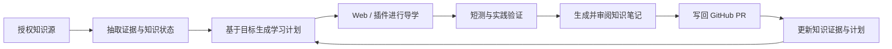

# 产品愿景与定位（Product Vision）

Version 1.0 · 2026-10-24

## 1. 一句话定位
FrontierLearn 是基于个人真实知识证据、会主动规划且能够长期进化的 AI 导师。它借助 Web 工作台和浏览器插件，在用户学习前沿技术、项目工程、AI 论文及对话资料时提供因人而异的导学过程，并将经验回写用户原有知识库。

## 2. 核心问题
1. 信息泛滥：打开 arXiv/Hugging Face/GitHub 不知道看什么；
2. 学习起点模糊：已有基础与真实掌握程度没有被应用使用；
3. 导读和实践断裂：读懂术语但无法独立验证或复用；
4. 知识资产孤岛：GitHub、博客、Notion 和 AI 对话无法共同支持学习规划；
5. 缺少长期反馈：上次学习不影响下次学习，重复从零开始。

## 3. 用户与非用户
- **首批核心用户**：已经积累部分技术知识并希望系统进入 AI 前沿技术的开发者、工程师、研究学习者。
- **同样支持**：仅有初步基础或尚无知识库的新用户，通过自我评估、简短入门问答或手动导入建立起点。
- **非目标**：仅需要整篇论文一键翻译、每日自动生成海量资讯摘要、无教学过程的论文代写或无人审核的自动知识发布。

## 4. 关键价值主张
| 价值 | 不是 | 而是 |
|---|---|---|
| 理解用户 | 从用户声明的“我熟悉 Python”直接打标签 | 从 Markdown、代码、课程、学习记录、测验得出带证据的概率性判断 |
| 规划学习 | 固定课程清单 | 目标 × 知识缺口 × 兴趣 × 可用时间 × 学习证据的动态计划 |
| 导学 | 通篇翻译 / 长篇总结 | 建立学习入口、层级解释、问答、来源追踪、短验证 |
| 沉淀 | 全自动堆积摘要 | 草稿 → 人工校对 → PR/知识库写入 → 增量重建知识状态 |
| 长期价值 | 追踪访问量 | 提高开始学习比例、理解与迁移的成功率 |

## 5. 产品形态
- **Web 工作台：** 登录和数据源授权；学习目标；知识画像及证据；路线与当日任务；笔记草稿及同步审核；学习历史和复习。
- **Chrome Side Panel 插件：** 用户显式启动的当前网页/选区提取；arXiv、HF、部分 ChatGPT 可解析分享页；读取个人学习上下文，展示当前内容的个性化学习路径和教学问答。
- **桌面端（未来）：** 大量本地文件、脱机学习、IDE/代码实践、沙箱执行；当前不做。
- **共用：** 身份、学习者模型、计划、课程与导学会话、同步任务；不维护三份彼此冲突的用户状态。

## 6. 核心闭环

## 7. 示例验证资产（不硬编码到产品）
- GitHub 技术笔记：<https://github.com/Garden12138/notes>；含 BPE、Attention、Hello-Agents、vLLM 部署等文件。
- Hexo 公开博客：<https://garden12138.github.io/>；其 `Garden12138.github.io` 当前看起来是生成后的站点产物，发布应关联独立的 Hexo 源 Markdown（需用户另行授权）。
- AI 分享链接：支持用户提供 ChatGPT 等分享 URL，若正文不可读则回退到复制粘贴/上传，且每条对话中的 AI 论点不能直接作为事实。

## 8. 未来愿景
由个人技术导师延伸为“项目驱动学习 + 前沿技术雷达 + 研究洞察 + 本地实践”的个人知识成长系统。此愿景见 `docs/roadmap.md`，不会默认进入本期开发。
