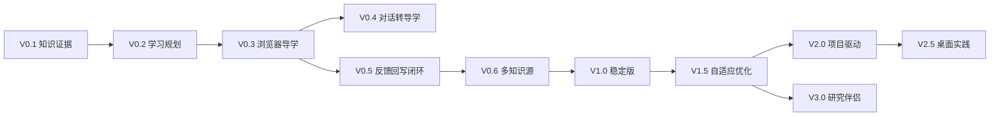

# FrontierLearn 产品路线图（Product Roadmap）

**Version:** 1.0 · **Status:** Strategic proposal · **Last reviewed:** 2026-10-24  
**管理原则：** 本文档包含未来方向，不代表功能承诺、研发排期或已验证市场需求。先完成 V0.1–V0.5 的学习闭环再决定下一阶段。各版本实施前应建立独立 `spec.md/plan.md/tasks.md`，不要把所有路线图功能直接塞进当前 MVP。

## 1. 北极星目标
在用户已有基础上，持续提升“独立理解新技术并完成验证性实践”的能力。

用户价值链：**已有知识 → 知识缺口 → 主动规划 → 精准阅读 → 练习验证 → 笔记沉淀 → 再规划**。

## 2. 版本概览

| 版本 | 阶段主题 | 形态 | 核心交付 | 退出条件 |
|---|---|---|---|---|
| V0.1 | Know Me | Web 基础 | GitHub 只读连接、知识证据、初始画像 | 每个画像判断有依据；增量导入可复现 |
| V0.2 | Guide Me | Web | 目标、知识缺口、分层计划、当日任务 | 推荐原因清楚；无知识库也可用 |
| V0.3 | Learn With Me | Extension + Web | arXiv/HF 导读、选区解释、来源定位 | 用户能从网页直接开始一个个性化任务 |
| V0.4 | Conversation to Learning | Extension + Web | ChatGPT 共享页/粘贴对话→导学任务 | 能处理可读和不可读分享链接 |
| V0.5 | Close the Loop | Extension + Web | 理解验证、Markdown 草稿、GitHub PR、重规划 | 两次连续学习中第 2 次确实利用第 1 次验证结果 |
| V0.6 | More Knowledge Sources | Web + Extension | Notion 只读/可控写入、Hexo 源草稿、本地 Markdown 导入 | 跨源知识不重复、冲突可解决 |
| V1.0 | Reliable Personal Tutor | 双入口正式版 | 稳定同步、分级复习、隐私、安全、可观测、体验打磨 | 核心指标达标，能服务小规模真实用户 |
| V1.5 | Adaptive Learning | 双入口 | 动态难度、先修诊断、学习策略实验、学习回顾 | 个性化优于固定路线的可测学习效果 |
| V2.0 | Project-driven Learning | 双入口 + 开发工具连接 | GitHub 项目识别、代码仓库技能差距、项目学习计划 | 从学习任务到项目贡献的可验证路径 |
| V2.5 | Desktop Practice Hub | 可选桌面端 | 本地 Markdown/Obsidian/IDE、沙箱代码实验、离线索引 | 本地使用需求真实且收益高于维护成本 |
| V3.0 | Research Companion | 生态化 | 技术雷达、创新洞察、跨材料研究地图、开放插件 | 在来源可靠性和评估数据下验证价值 |

## 3. Now / Next / Later

### NOW：V0.1–V0.5（核心假设验证）
必须保证 Web 与插件共享 Learning Engine。优先解决“认识已有知识并调整下一次学习”的可证明闭环。只使用可控的 GitHub Markdown 与明确授权的网页/分享链接。原则上没有桌面端、社交、自动科研、自动博客发布。

**重点评估：** 画像是否有证据、导学是否避免重复入门、练习是否改变后续计划、笔记回写是否准确且不破坏旧文件。

### NEXT：V0.6–V1.5（可持续使用）
多源连接器、稳定增量索引、更加可靠的评估与复习机制、模型选择和隐私选项、端到端可观测、移动浏览友好的 Web 页面。开始小规模用户验证，不因同步能力扩展而引入不可控自动写入。

**重点评估：** 跨源去重、学习回访率、学习成果保持、系统安全和实际成本。

### LATER：V2.0–V3.0（差异化竞争力）

#### A. 项目驱动式学习（V2.0）
- 输入 GitHub 仓库/具体 Issue/现有本地项目，分析核心模块与学习要求；
- 将学习路线映射到可交付项目任务，不仅生成论文清单；
- 引导实现、运行验证、生成 PR 草案，绝不未经确认自动提交/运行不可控代码；
- 评估“能否解决原始工程问题”，而非只完成问答。

#### B. 桌面实践中心（V2.5）
- 读取用户选定目录的 Markdown、PDF、Obsidian vault（仅经授权的目录）；
- 通过沙箱/容器运行学习实验，记录环境、依赖、结果与失败原因；
- 与 IDE/Codex/终端交互，但执行命令前要展示计划、权限与风险；
- 研究离线 Embedding/离线 LLM，并保留云端模型可选路径。

#### C. 前沿技术雷达与研究洞察（V3.0）
- 针对学习目标汇聚论文/模型/工程项目；
- 将“值得关注的技术变化”与“我已有的知识”关联；
- 生成可实践点、潜在产品机会与验证建议；
- 区分已核实研究发现、AI 推测、商业假设，不把产品价值评估写成事实；
- 用户明确订阅后才提供定期推荐和提醒。

#### D. 开放生态（条件触发，非必做）
Connector SDK、导学策略插件、外部学习成就导入、多端同步、本地优先模式、企业/教育场景；先验证 API 稳定性、权限模型和实际需求，再开放。

## 4. Roadmap Dependencies

**注**：依赖是优先顺序建议，不代表商业发行版必须按数字逐一发布。V0.4 共享链接能力可以以实验标志后移，但 V0.5 的 GitHub 学习闭环必须可独立验证。

## 5. Release Gates and Stop / Go Criteria

| Gate | Go 条件 | 未达标时处理 |
|---|---|---|
| G1 知识证据有效 | 引用可复查，画像不会因 AI 对话自动标熟练 | 暂停主动规划优化，修正证据模型 |
| G2 导学可用 | 用户在真实网页中知道第一步做什么，来源定位准确 | 收敛站点类型，优先修页面解析 |
| G3 学习增长 | 至少连续两次学习里第二次推荐利用前次真实评价 | 不扩展 Notion/桌面端，先修状态更新 |
| G4 同步安全 | 无未经授权写主分支，冲突无数据损坏，撤销可用 | 冻结写回功能，保留导出模式 |
| G5 规模与价值 | 稳定性和用户学习成效可测，成本可接受 | 限定用户群，重新审查目标与范围 |

## 6. 未来未决产品问题

1. 是专注 AI 技术学习者，还是开放到所有 STEM 学习者？先聚焦 AI 工程开发者，再看跨领域迁移。
2. 个人知识模型是否应本地优先？如果隐私诉求强于跨端同步，需调换存储架构优先级。
3. 对话导学是否值得独立产品化？先测真实导入频次与后续练习完成率。
4. 是否支持内容发现/技术雷达？应先验证“推荐的学习内容”比用户主动检索更有价值。
5. 桌面实践中心是否真有必要？若浏览器 + CLI/IDE 插件已满足需求，则不必做独立桌面 App。
6. 面向商业化是否采用 BYOK、订阅额度或自托管？先通过小规模真实使用估算成本和留存，不预设定价。

## 7. 版本治理模板
每次规划下一版本时，必须回答：
- 用户行为证据是什么？
- 当前版本最大的学习障碍是什么？
- 哪三个可量化指标会因为新功能改善？
- 是否能通过改进现有双入口解决，而不是创建新平台？
- 数据授权和知识归属是否更复杂？
- 回滚和停用功能的方式是什么？

不满足以上问题，不应仅凭“技术上能实现”将新方向纳入正式开发。
