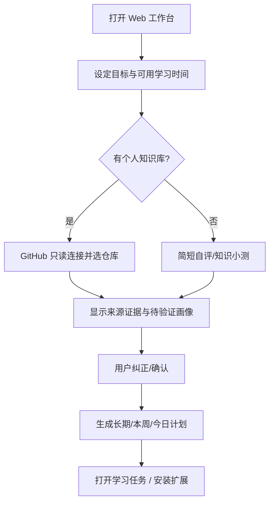
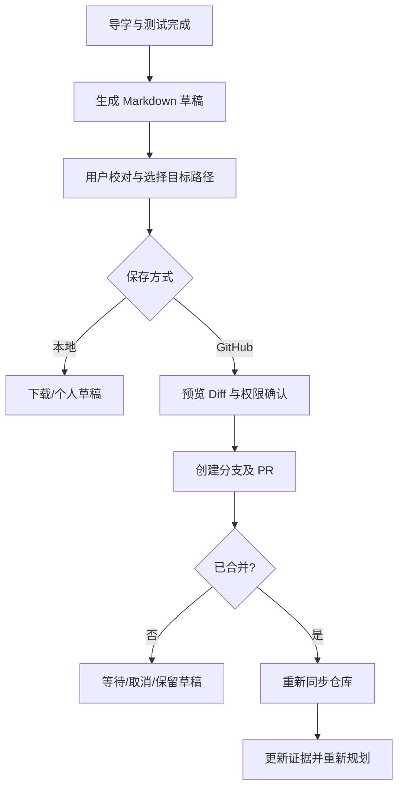

# 交互流程与信息架构（UX Flows）

## 1. 双入口产品 IA

### Web Workspace
- Home：今日继续学习、当前目标、推荐原因、学习会话入口；
- Goals & Paths：长期路线、阶段计划、当日任务，允许暂停和重排；
- My Knowledge：概念状态、对应证据、相关笔记/代码、纠错入口；
- Sources：GitHub/未来 Notion/博客/聊天来源授权、同步、删除；
- Sessions & Artifacts：问答、测验、草稿、PR 状态、学习历史；
- Settings：模型数据处理选项、API 凭据、数据导出和注销。

### Extension Side Panel
- 当前页卡片：来源与解析范围、当前知识关系、建议学习入口；
- Reading Guide：本页 3 个关键问题与阅读路线；
- Ask & Explain：选中内容解释、层次选择、追问；
- Check Understanding：简短测验与反馈；
- Save & Review：生成草稿、在 Web 工作台审核和同步。

## 2. First Run（首次使用）

**空状态**：用户未连接任何外部数据时仍可通过自评生成计划。**隐私**：每个源单独授权，不得在配置过程要求读取所有仓库。

## 3. Learn on arXiv / Hugging Face

1. 用户打开网页并点击 Side Panel“分析本页”；扩展只读取当前明确授权的网页内容。
2. 插件先展示“这是什么、与你的学习目标有何关系、建议读哪 3 段”，而不是先输出几千字摘要。
3. 用户选择 `直观`、`原理` 或 `实践`。若已有知识证据，解释为何跳过某些基础；不确定时给短校验。
4. 用户选中原文，插件给出带原文来源锚点的解释，可跳回该段；锚点失败明示。
5. 过程中可以记“没懂/值得实践/稍后再读”，并添加到学习计划。
6. 结束时做 1–3 题短测或领取一个验证性实践任务；保存学习结果。

**辅助状态**：空网页 / 仅摘要 / 不支持 PDF / 页面动态加载 / 大文本 / 无模型额度 / 未登录。每种要有可理解的恢复路径。

## 4. Conversation → Learning

- 通过分享 URL 或复制对话正文导入。预览个人隐私内容后再确认进入模型处理。
- 提取对话中的 `用户困惑`、`AI 解释`、`技术结论`、`代码`、`未验证断言`；显示可追溯位置。
- AI 导师只根据尚未验证的关键问题生成后续学习任务，不默认接受所有 AI 观点。
- 用户可选择“今天学”“以后学”“只收藏”“忽略”。

## 5. Save Knowledge（回写）

## 6. Content Style & AI Behavior

- 先给学习目标和预计的步骤数，再给重要问题；长篇内容按需展开。
- 分离原文摘录、AI 解说、用户笔记、自我测验反馈；不将三者混成一个“总结”。
- 公式和代码优先以最小例子解释，再进入正式推导；不要默认用户能看懂所有公式，也不要因笔记存在就跳过必要定义。
- 用户可切换阅读深度，停止导学，拒绝执行建议；低频打断，避免教学过度主动而妨碍独立阅读。
- 采用中文 UI + 保留关键英文术语，提供开放英文国际化支持。
