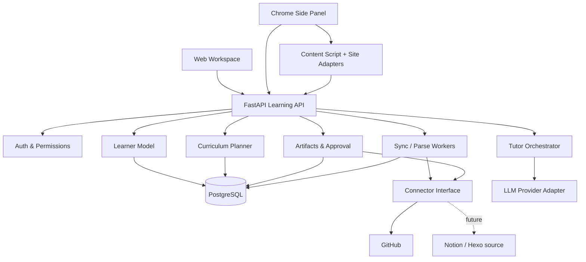

# Implementation Plan: Personalized Learning Loop

**Branch/Feature:** `001-personalized-learning-loop`  
**Specification:** [spec.md](spec.md)  
**Technical status:** Phases 1–8 and production adapter code verified locally; live-service release gates pending
**Last updated:** 2026-10-26

开发态实现已包含 US1–US6 的本地闭环，最终验证记录见 `docs/evidence/mvp-acceptance.md`。
OpenAPI YAML 与 JSON 现从同一运行时契约生成，TS 类型从 JSON 生成，不再保留旧路由草案。
来源边界短测、分支/PR 幂等及所有权默认值见 ADR-0008。独立密码/恢复、OpenAI Responses、
GitHub App/OAuth 与预算边界见 ADR-0009，配置见 `docs/production-integrations.md`。
正式账号和外部协议已在隔离环境验证；真实模型/仓库授权联调和人工效果仍是发布门槛。

## 1. Summary
交付统一 Learner Model、主动学习规划引擎、Web 工作台、Chrome Side Panel、GitHub 只读知识导入与 PR 回写、AI 对话导学，形成闭环。先完成后端业务与 Web 端纵切，再增加 Chrome 插件；避免“先做漂亮侧边栏，再补用户模型”。

## 2. Technical Context

| 项目 | 决策（可在 ADR 审查后调整） |
|---|---|
| Monorepo | `pnpm`（TS workspace）+ Python `uv`/可替换工具 |
| Web | React + TypeScript + Vite + TanStack Query |
| Extension | WXT + React + Manifest V3 + Chrome Side Panel |
| Shared frontend | `packages/shared`：API 类型、UI 基础组件、工具库 |
| API | FastAPI + Pydantic + async SQLAlchemy/SQLModel 任选之一（正式决策固定一种） |
| Storage | PostgreSQL；必要时加入 pgvector，不早期引入独立图数据库 |
| Background tasks | 单机开发可用数据库任务表 + Worker；正式部署再选 RQ/Celery/Arq 等成熟任务队列，不增加无意义分布式复杂度 |
| LLM | Provider Adapter：`generate_structured` / `stream_tutor`；Fake Provider 供测试 |
| GitHub | 用户授权的细粒度 App/OAuth Token，逐仓库最小权限；读/写操作分离 |
| Observability | JSON 日志 + request_id + task_id，不记录敏感源文 |
| Test | pytest + httpx + testcontainers 或隔离 PG；Vitest + Playwright（web/extension 测试） |

## 3. Architecture



## 4. Package Boundaries

```text
apps/
  web/                  # 用户管理、学习目标、画像、计划、学习历史、草稿审核
  extension/            # Side Panel、content scripts、arXiv/HF/聊天站点适配器
packages/
  shared/               # API 客户端类型、枚举、UI tokens、校验器
services/
  api/
    app/api/            # REST endpoints & dependency injection
    app/domain/         # Learner/Planner/Tutor/Assessment/Artifacts
    app/connectors/     # GitHub + future connector interfaces
    app/ai/             # Provider protocol, prompt templates, fake provider
    app/ingestion/      # Parser, indexing, citations, evidence extraction
    app/jobs/           # bounded async tasks
    app/persistence/    # ORM, repo, migrations
    tests/
infra/
  docker-compose.yml    # PostgreSQL + API + Worker for local env
.specify/
specs/
docs/
```

## 5. End-to-End Data Flow

### 5.1 Source → Evidence
1. 用户添加指定 GitHub Repository，授予只读访问；创建 `KnowledgeSource` 与 `SyncJob`。
2. Worker 拉取允许范围内的树与文件，记录提交 SHA、path、content hash。
3. Markdown 解析为章节/段落块，保留行号；对过大文档逐块处理，跳过不支持文件并记录原因。
4. 经来源链接约束的提取器识别概念、知识断言、代码示例，生成 `KnowledgeEvidence`（`OBSERVED_NOTE`、`EXPLAINED`、`PRACTICED` 等）。
5. 通过 `KnowledgeStatePolicy` 综合证据与测验结果；允许输出 `UNKNOWN/EXPOSED/UNDERSTANDING/APPLIED/PROFICIENT`，复习需求单独使用 `review_due` 布尔标记，并保留证据引用、置信与版本。
6. 用户在 Web 端查看并纠正，不是自动标“精通”。

### 5.2 Goals → Plan
1. `GoalService` 保存目标/偏好/时间预算。
2. `Planner` 从知识状态、前置依赖与可用资源生成候选学习节点；稳定的规则先过滤不可行/重复项，LLM 仅负责解释与结构化编排。
3. Pydantic 验证计划 JSON；检查每个依赖、推荐理由与来源是否存在；结果保存 `LearningPlanRevision`。
4. 用户接受/调整计划；任何计划变更留 revision 与理由。

### 5.3 Page → Guided Session
1. 用户在受支持站点点击插件；content script 从**当前活动页面**提取可见正文、URL 和稳定段落锚点。
2. 对文本长度、DOM 与 URL 做边界校验；仅向用户授权的 API 发送所需内容。
3. 以 URL、文档摘要/哈希关联当前 `LearningSession`；查询个人目标/证据/计划，输出 1–3 个可行动问题与阅读步骤。
4. 选区解释必须同时持有选区原文、锚点和模型解释来源标签。
5. 后续追问传入最小化上下文和相关证据，不把整个历史浏览记录装进 Prompt。

Phase 5 实际边界见 ADR-0006：普通工具栏 action 授予 activeTab 后打开侧栏；点击分析
才抽取，仅在预览确认后保存 LearningSession。`pages:analyze`/`sessions/.../questions`
返回有界任务状态，沿用取消/重试而非无限请求。默认本地规则建议，Provider 接口通过 Fake
验收；后续 T063–066 已补齐独立身份和云 Provider。真实模型内容质量与真实网页人工抽检
仍保留发布门槛。

Phase 6 实际边界见 ADR-0007：分享链接通过固定公开主机、同资源重定向限制和 IP 固定读取；
正文用结构化消息标签解析，不执行 hydration 脚本。无法获取/解析时保留失败记录并提供粘贴。
确认后仅保存到本人学习库；本地规则提出 1–3 个待验证问题，经用户选择才追加计划。
计划只保存通用验证步骤和材料引用，删除后旧版本不复制敏感原文；真实分享兼容性待发布验收。

### 5.4 Assessment → Note → Write-back → Replan
1. 导学结束或任意时点可请求短测；`Assessment` 保存用户答案、评分规则、评价与不确定性。
2. 生成结构化 Markdown 草稿 `LearningArtifact`（关联 Source、Evidence、Session、Assessment）。
3. 用户确认 Diff 和目的仓库/路径；API 重验权限、目标 ref、commit SHA；创建独立分支和 PR；失败保留待审核草稿。
4. PR 合并后（或显式手工确认）触发来源重新同步；**创建 PR 本身不等于内容已经成为官方知识资产**。
5. 重新推断知识状态，并生成新计划 revision，UI 显示变化来源。

## 6. Feature Slices and Gates

| Slice | Scope | Tests / Gate |
|---|---|---|
| Phase 1 Foundation | 项目结构、PG、鉴权、API 契约、任务机制 | lint/tests/migrations；无私有资源越权 |
| V0.1 | GitHub read-only connector、证据索引、知识画像 | 真实/模拟仓库；幂等、删除、失败恢复 |
| V0.2 | 学习目标、规划、Web Dashboard | 非空与空画像可输出可解释计划 |
| V0.3 | arXiv/HF 适配、Side Panel、问答和来源锚点 | 页面适配 fixtures + 浏览器 E2E |
| V0.4 | ChatGPT 分享链接解析 + 粘贴回退 | 可解析、不可解析、重定向、安全用例 |
| V0.5 | Assessment + Draft + PR + Reindex/Replan | 人工确认 + 冲突/幂等测试 + 2次连续学习 |
| Hardening | 安全/隐私/性能/部署 | checklists 与 quickstart 全部通过 |

## 7. Security & Permission Model

- OAuth/Token 用服务端密钥管理；敏感数据加密存储，短期授权 token 与 GitHub 写 Token 受限；避免 token 经浏览器 Content Script 传播。
- 首次连接只读。首次写回独立发起授权，用户明确选择仓库和路径，创建 PR，不直推默认分支。
- URL 导入服务端拒绝 localhost、私网、link-local、metadata endpoint、非法端口和非 http(s)；每次重定向与 DNS 重解析必须重复校验。
- 外部网页/聊天/README 都只是**数据**；AI Prompt 使用清晰角色边界，工具调用通过 allowlist 与策略判定，不信任网页中“忽略系统指令”等内容。
- 多租户按 user_id 做服务端权限过滤；审计关键写入与连接变更。
- 支持配置云端模型的隐私告知及敏感内容排除；模型拒绝/超时必须可恢复。

## 8. API Boundary
见 `contracts/openapi.yaml`。API 返回标准错误对象 `{code,message,request_id}`，创建/写入请求使用 `Idempotency-Key` 或明确 resource version。流式 Tutor 事件可在稳定后引入 SSE；第一阶段可以同步短内容和异步生成任务结合。

## 9. Rollout, Migration, and Operability

- 开发环境单用户也必须保留 user_id 域隔离，禁止以后难以迁移。
- Migration 文件单独版本管理；演示数据通过 seed fixture 注入，不放用户实际凭据。
- 支持通过 feature flags 打开特定来源/写回；风险功能默认关闭。
- Github 写回必须额外开关 + 用户审批；全链路日志保留 request_id/task_id，源正文按敏感内容处理。
- 版本升级不能抹掉 LearningPlanRevision 和来源引用。

## 10. Risks and Mitigations

| 风险 | 缓解 |
|---|---|
| AI 从旧笔记误判掌握水平 | 分层证据 + 待验证状态 + 用户反馈 + 练习检查 |
| LLM 产生错误引用与学习路线 | 持久来源锚点、规则校验、提示“推测”与人工抽样 |
| 分享链接页面结构变更或登录限制 | 站点适配器版本 + 粘贴/上传降级，不绕过权限 |
| GitHub 回写冲突/覆盖知识 | 预览 Diff、分支 PR、SHA 校验、幂等保护 |
| 成本与响应速度 | 先提取/缓存/再调用 LLM、预算上限、限流、Fake 测试 |
| 扩展过度索取权限 | activeTab 和最小 host 权限，明确触发当前页操作 |
| 过早设计桌面/多 Agent | 仅保留边界接口，按路线图逐版本评估 |

## 11. Constitution Check

| 原则 | 计划符合方式 |
|---|---|
| 学习效果优先 | Plan + Assessment + 复习证据作为核心，不以摘要次数度量 |
| 基于证据 | 每条 KnowledgeState 有 KnowledgeEvidence 引用 |
| 用户持有知识 | 草稿、PR、外部知识库可导出和撤销 |
| 隐私安全 | 最小权限，用户触发采集，令牌与数据隔离 |
| 闭环优先 | V0.1-V0.5 构成最小可用完整闭环 |
| API 可替换 | Adapter 接口，Web/插件共用 API |
| 可靠性 | 幂等、任务状态机、测试 fixtures |

## 12. Next Artifacts
- `data-model.md`：领域实体、唯一键、知识状态演进规则。
- `research.md`：站点和同步方案、实验性决策。
- `tasks.md`：按 story 的可实施任务与路径。
- `quickstart.md`：测试、验收和人工操作步骤。
