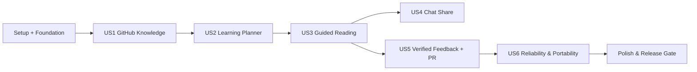

# Tasks: Personalized Learning Loop

**Status**: Planned, not implemented · **Date**: 2026-10-24 · **Spec**: [`spec.md`](spec.md)

## Execution Policy

- 这些是面向 Codex 的可执行任务建议，**未完成的任务一律保持 `[ ]`**。
- 任务按阶段和用户故事排序，带 `[P]` 的任务表示与同阶段其他不依赖任务可并行；必须自己判断真实依赖是否满足。
- 每阶段完成时先运行相应测试并核对 `quickstart.md`，不可仅凭生成代码勾选。
- 当前工作限定 V0.1–V0.5 首个闭环。`docs/roadmap.md` 中 V0.6–V3.0 不在该清单中。

## Task List

### Phase 1: Setup（全局初始化）

- [ ] T001 [P] 初始化 monorepo 结构和 pnpm workspace，建立 `pnpm-workspace.yaml`、`package.json`、`apps/web/`、`apps/extension/`、`packages/shared/`。
- [ ] T002 [P] 在 `services/api/pyproject.toml` 初始化 Python FastAPI、静态分析与测试配置。
- [ ] T003 [P] 创建本地开发编排 `infra/docker-compose.yml`（PostgreSQL + API + Worker 预留），配置 `.env.example`。
- [ ] T004 建立 `services/api/app/main.py` 与健康检查端点 `services/api/app/api/health.py`。
- [ ] T005 建立 `services/api/app/persistence/migrations/` 与启动数据库迁移/回滚脚本。
- [ ] T006 设置 `apps/web`、`apps/extension`、`services/api` 的 Lint/Test/Build CI（`.github/workflows/ci.yml`）。

### Phase 2: Foundation（跨 Story 阻塞能力）

- [ ] T007 在 `services/api/app/auth/` 实现用户身份、资源级授权与 Token 生命周期（用 Mock 登录先验证边界）。
- [ ] T008 在 `services/api/app/persistence/models.py` 定义基础用户/知识源/任务/审计实体和迁移。
- [ ] T009 [P] 在 `services/api/app/ai/provider.py` 定义 Provider 协议、`fake_provider.py` 和结构化输出校验。
- [ ] T010 [P] 在 `services/api/app/jobs/` 实现有限重试、超时、幂等和任务状态 API。
- [ ] T011 在 `services/api/app/core/security.py` 实现加密令牌储存、配置校验、隐私日志脱敏和服务端 SSRF 防护工具。
- [ ] T012 在 `packages/shared/src/api/` 生成/维护 OpenAPI 类型并建立共享错误处理组件。
- [ ] T013 [P] 编写 `services/api/tests/security/` 跨用户访问、恶意 URL、密钥泄露回归测试。

### Phase 3: V0.1 / US1 — Knowledge Import & Profile

- [ ] T014 [US1] 在 `services/api/app/connectors/base.py` 定义 `KnowledgeConnector` 的只读能力边界和 source-scope 结构。
- [ ] T015 [US1] 在 `services/api/app/connectors/github.py` 实现所选仓库文件树读取、版本 SHA 与分页/速率限制处理。
- [ ] T016 [P] [US1] 在 `services/api/app/ingestion/markdown.py` 实现可控大小解析、章节与行号锚点，忽略不支持资源。
- [ ] T017 [US1] 在 `services/api/app/ingestion/evidence.py` 实现概念提取、证据分类与对原文 locator 的合法性校验。
- [ ] T018 [US1] 在 `services/api/app/domain/knowledge_policy.py` 实现 UNKNOWN/EXPOSED 等规则（严禁只因笔记就标精通）。
- [ ] T019 [US1] 在 `services/api/app/domain/knowledge_sync.py` 实现增量同步、重命名候选、删除证据和幂等哈希。
- [ ] T020 [P] [US1] 在 `services/api/app/api/sources.py` 与 `knowledge.py` 暴露连接/任务/画像与证据 API。
- [ ] T021 [US1] 在 `apps/web/src/pages/KnowledgeSources.tsx` 与 `KnowledgeProfile.tsx` 实现选择仓库、查看进度与来源证据。
- [ ] T022 [US1] 在 `services/api/tests/integration/test_github_ingest.py` 验收 E2E-002～005、权限拒绝、坏文件不中断批次。

### Phase 4: V0.2 / US2 — Active Curriculum Planning

- [ ] T023 [P] [US2] 在 `services/api/app/domain/goals.py` 实现目标和可用时间约束的持久化与编辑。
- [ ] T024 [US2] 在 `services/api/app/domain/planner.py` 实现先修关系、证据差距、任务筛选与结构化计划 JSON 校验。
- [ ] T025 [US2] 在 `services/api/app/domain/plans.py` 建立 LearningPlanRevision、任务接受/重排/跳过、推荐来源。
- [ ] T026 [US2] 在 `apps/web/src/pages/Today.tsx` 与 `Goals.tsx` 实现今日任务、目标与计划修订展示。
- [ ] T027 [P] [US2] 在 `services/api/app/api/goals.py`、`plans.py` 实现目标和计划 API。
- [ ] T028 [US2] 在 `services/api/tests/test_planner.py` 覆盖空知识库、错误先修依赖、无证据置信与计划修订。

### Phase 5: V0.3 / US3 — Web-guided Reading

- [ ] T029 [US3] 在 `apps/extension/wxt.config.ts`、`entrypoints/sidepanel/` 配置 Manifest V3 Side Panel UI 和最小权限。
- [ ] T030 [P] [US3] 在 `apps/extension/entrypoints/content/` 实现用户触发的当前网页抽取、选区定位与授权边界。
- [ ] T031 [US3] 在 `apps/extension/src/adapters/arxiv.ts` 实现摘要/HTML 结构化导读适配器，缺失正文时标记范围。
- [ ] T032 [US3] 在 `apps/extension/src/adapters/huggingface.ts` 实现 HF Model Card 适配器。
- [ ] T033 [US3] 在 `services/api/app/domain/tutor.py` 实现用户目标/画像/当前页的最小上下文检索与三种解释模式。
- [ ] T034 [US3] 在 `services/api/app/api/pages.py` 与 `sessions.py` 实现读取导学、追问、引用定位、学习会话。
- [ ] T035 [US3] 在 `apps/extension/src/features/guide/` 构建导读、选区解释、加载与错误降级 UI。
- [ ] T036 [P] [US3] 在 `apps/web/src/pages/Sessions.tsx` 展示与插件共享的会话和当前学习任务。
- [ ] T037 [US3] 在 `apps/extension/tests/` 与 `services/api/tests/test_citations.py` 覆盖 10 个结构化网页 fixtures、锚点正确性。

### Phase 6: V0.4 / US4 — Conversation to Learning

- [ ] T038 [US4] 在 `services/api/app/ingestion/safe_fetch.py` 实现公共分享 URL 允许列表/SSRF 防护与可观测失败状态。
- [ ] T039 [US4] 在 `services/api/app/connectors/chatgpt_share.py` 解析可访问共享页中的角色、段落和代码，不使用越权接口。
- [ ] T040 [US4] 在 `apps/web/src/pages/ImportConversation.tsx` 增加粘贴文本/URL、内容预览与隐私确认。
- [ ] T041 [US4] 在 `services/api/app/domain/conversation_learning.py` 把对话中待验证问题映射到候选学习任务（非“已掌握”）。
- [ ] T042 [US4] 在 `services/api/tests/test_share_import.py` 验收可解析/不可解析/手动文本/敏感数据提示。

### Phase 7: V0.5 / US5 — Assessment, Draft & Writeback

- [ ] T043 [US5] 在 `services/api/app/domain/assessment.py` 实现题目、rubric、答案、反馈及非精确的能力证据更新。
- [ ] T044 [US5] 在 `apps/extension/src/features/assessment/` 和 `apps/web/src/pages/Assessment.tsx` 实现短测与复查。
- [ ] T045 [US5] 在 `services/api/app/domain/artifacts.py` 实现 Markdown 笔记草稿、来源、未验证结论和可视化 Diff 数据。
- [ ] T046 [US5] 在 `apps/web/src/pages/ArtifactReview.tsx` 实现新建笔记/合并候选/仅本地与明确写回审批。
- [ ] T047 [US5] 在 `services/api/app/connectors/github_writeback.py` 实现用户确认后的受限分支/PR 写回及版本冲突检查。
- [ ] T048 [US5] 在 `services/api/app/domain/replanning.py` 根据已确认学习证据刷新状态与计划 revision，展示变更原因。
- [ ] T049 [US5] 在 `services/api/app/api/assessments.py` 和 `artifacts.py` 实现笔记草稿、批准、幂等与任务状态契约。
- [ ] T050 [US5] 在 `services/api/tests/integration/test_learning_loop.py` 覆盖两次连续学习、PR 合并后再索引/重规划。
- [ ] T051 [US5] 在 `services/api/tests/integration/test_writeback_safety.py` 覆盖未经确认、重复请求、冲突、撤销权限。

### Phase 8: Cross-cutting / US6 — Reliability & Ownership

- [ ] T052 [US6] 在 `services/api/app/api/settings.py` 与 `services/api/app/domain/data_portability.py` 实现数据导出、断连、内部删除。
- [ ] T053 [US6] 在 `apps/web/src/pages/Settings.tsx` 提供模型处理授权、同步暂停、来源解绑及删除二次确认。
- [ ] T054 [US6] 在 `services/api/tests/integration/test_portability.py` 测试用户数据导出、删除与其他源证据保留。
- [ ] T055 [US6] 在 `services/api/app/jobs/` 完善预算、任务取消、失败重试与作业状态界面联动。
- [ ] T056 [US6] 在 `services/api/tests/security/test_prompt_injection.py` 加入恶意 Markdown/分享页/选区内容测试。

### Phase 9: Polish & MVP Release Gate

- [ ] T057 [P] 在 `apps/web/tests/e2e/` 补齐首次使用、空画像、学习目标、草稿审核 E2E。
- [ ] T058 [P] 在 `apps/extension/tests/e2e/` 验证 arXiv/HF 页面、当前页授权和登录失效状态。
- [ ] T059 执行 `specs/001-personalized-learning-loop/quickstart.md` 的 E2E-001～022，记录结果与截图（不包含隐私）。
- [ ] T060 执行 `specs/001-personalized-learning-loop/checklists/requirements.md`，审核安全边界、数据删除与来源真实性。
- [ ] T061 在 `docs/metrics-and-quality.md` 记录真实性能、来源准确率和用户测试结果，调整未验证指标表述。
- [ ] T062 更新 `README.md` 的本地启动、测试、部署与回滚说明；提交 release note 和尚未解决问题。

## Dependency Graph

- 技术基础必须先可运行，跨用户权限和 Fake LLM 不能留到最后补。
- **首个可演示纵切**：US1 → US2 可生成个人计划；**首个完整 MVP**：US1 → US2 → US3 → US5；US4 可用实验功能标志独立完成，不影响主链路验收。
- 并行示例：US3 的 arXiv/HF Adapter 可在 `tutor.py` API 契约稳定后并行；US5 的前端 Diff 页面可在 Artifact DTO 固定后并行；不同任务同文件编辑不标记 `[P]`。

## Definition of Done per User Story

- US1：E2E-002～005；每条知识状态有证据路径，重复导入不重复。
- US2：E2E-001/006；无知识库也能生成解释性计划，历史 revision 存在。
- US3：E2E-007～010；侧边栏仅处理已授权页面，引用可定位。
- US4：E2E-011～012；访问失败可安全降级，AI 内容不增掌握度。
- US5：E2E-013～018；显式批准后 PR、失败草稿保留、下一次计划有变化依据。
- US6：E2E-019～022；跨用户不可访问，数据清理准确，恶意内容不可操控工具。

## Future Feature Policy

V0.6+ 的 Notion、Hexo 写回、桌面端、自动化发现/研究洞察、Coding Agent 远程执行等，必须先在新的 `specs/002-*`、`specs/003-*` 中定义独立规格和验收；不得以 `docs/roadmap.md` 为由提前写入本任务表。
